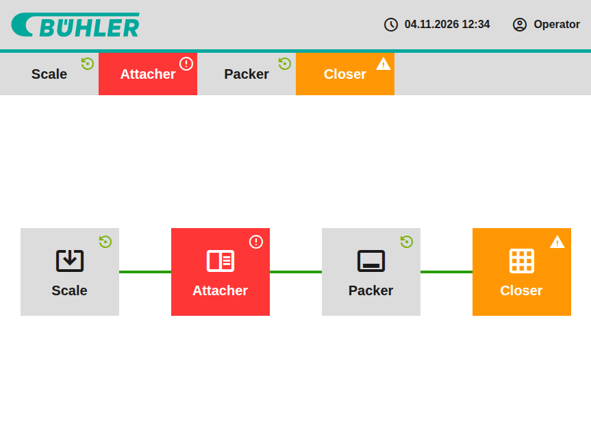
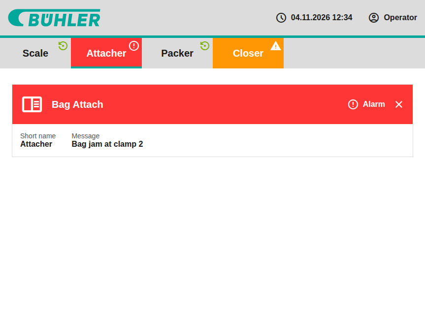

# Bühler Line Monitor

Angular application for monitoring a product-bagging production line of four machines:
**Scale → Bag Attach → Packer → Bag Closer**. Each machine is either _Running_, in _Warning_ or in
_Alarm_, and every state has its own icon and color.



The screen has three parts, all built to match the reference mockup (`docs/mockup.png`):

- **Header**: the Bühler logo (links back to the overview), a live clock and the signed-in user.
- **Navigation bar**: every machine with its state; the machine whose detail is open is marked.
- **Content**: the **line overview** (machine tiles connected in line order) or, after clicking a
  machine, its **detail** with the fault message for machines in alarm or warning.



Both views always show the same state, because they read it from the same store.

## Getting started

Requires Node.js 24 and npm 11.

```bash
npm install
npm start                    # dev server on http://localhost:4200
npm test -- --watch=false    # unit and component tests (Vitest)
npm run lint                 # ESLint (angular-eslint, incl. template accessibility rules)
npm run build                # production build in dist/
npm run format               # Prettier
```

## Architecture

Angular 22, standalone components, signals, zoneless change detection (OnPush is the default).

```
src/app/
  core/            data and state, no UI
    models/        Machine, MachineState, User
    machine-store  machines from data/machines.json (httpResource) + live states
    user-store     signed-in user from data/user.json
    parse-machines runtime validation of the machines response
    machine-state-config  icon and label per state, machineLabel() for accessible names
  layout/header    logo, clock, user
  features/line    MachineNav, LineOverview, MachineTile, MachineDetail, machineExistsGuard
  shared/          Icon, MachineStateBadge, Clock
src/styles/        design tokens and the machine-state color mixin
public/data/       mock data (machines.json, user.json)
```

- **Data flow**: `MachineStore` loads `public/data/machines.json` with `httpResource`. The
  `parse` option validates the response and sorts it by line order once. Live state changes go
  through `updateState(id, state)`. They are kept apart from the loaded data, so an update that
  arrives before loading finishes is not lost. Components only read the store's signals.
- **Routing**: `/` shows the line overview; `/machines/:id` shows the machine detail instead.
  The id is bound to the component as an input. `machineExistsGuard` waits for the machines to
  load and redirects unknown ids to `/`.
- **Styling**: colors, spacing and sizes are CSS custom properties in `src/styles/_tokens.scss`.
  The background, text and icon colors of each state are defined once in
  `src/styles/_machine-state.scss`. The navigation bar, tiles and detail all use them through its
  `colors` mixin.

## Design decisions

- **Signal-based services instead of NgRx or `BehaviorSubject`.** At this size, a root service
  holding signals is enough. Templates read signals directly, `computed` derives state, and there
  are no subscriptions to clean up. RxJS stays the tool for event streams, such as a future
  real-time status feed.
- **The URL is the selection.** The selected machine comes only from the route, so links can be
  shared and the back button works. There is no separate "selected" state to keep in sync.
- **One source of truth per concern.** `MACHINE_STATE_CONFIG` holds the icon and label of each
  state, and the `machine-state` mixin holds its colors.
- **Validated input.** A response that doesn't match the model puts the store in its error state
  instead of crashing the views.
- **Accessibility.**
  - State is never conveyed by color alone: each link has one accessible name, such as
    "Attacher – Alarm".
  - All items are keyboard-reachable links with a visible focus outline.
  - The active machine is marked with `aria-current`.
- **Mockup fidelity over contrast.** The mockup's colors are kept even where they miss WCAG
  contrast. The gaps are documented in [`TODO.md`](TODO.md).
- **Small icon font.** The Material Symbols request downloads only the icons in use (`icon_names`
  in `src/index.html`).

## Testing

77 unit and component tests (Vitest, TestBed) cover:

- **Data:** the stores (loading, success, error, live and early updates) and the response
  validation. The mock data is checked against the model.
- **Components:** each one (rendering, state styling, accessible names, live updates).
- **Routing:** deep links, unknown ids, and waiting for the load.

Where a test had to be able to fail, it was mutation-checked: the code was deliberately broken to
confirm the test catches it.

## AI-assisted workflow

The app was built step by step with Claude Code. Project rules and conventions live in
[`CLAUDE.md`](CLAUDE.md). For each step:

1. The step was implemented on its own branch.
2. Lint, tests and build were run.
3. Screenshots of the built app were compared with the mockup.
4. A pull request was opened; from the navigation bar onwards each one was reviewed, and the
   review comments were addressed before merging.

Examples of review findings that led to changes:

- unvalidated responses;
- live updates lost while the data was loading;
- duplicated state colors;
- a watcher leaked by `toObservable` in the route guard;
- tiles and connectors that could shrink;
- tests that could not fail.

## Known issues and next steps

Known issues and deliberate deviations are tracked in [`TODO.md`](TODO.md). Mainly: color contrast
of the mockup palette, the header at phone widths, and loading/error states that render empty.

Possible next steps:

- **Live status updates.** A `MachineStatusSource` (mock, later WebSocket or SSE) feeding
  `MachineStore.updateState`, which already exists.
- **Resilience.** Visible loading and error states, and an `aria-live` announcement when a
  machine enters alarm.
- **Responsive header** for phone widths.
- **End-to-end tests** with Playwright, and **CI** (lint, tests, build) with GitHub Actions.
- **Later:** i18n, user roles, theming, and more machine details (e.g. since when a fault has been
  active).
